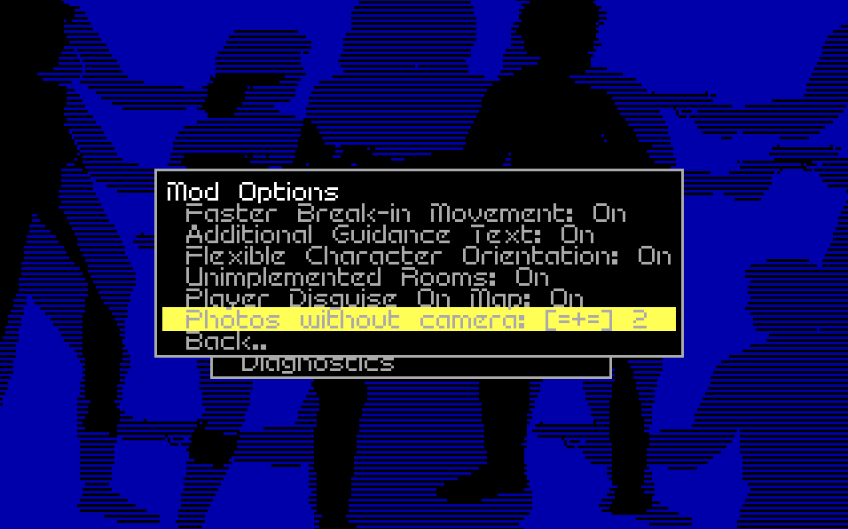
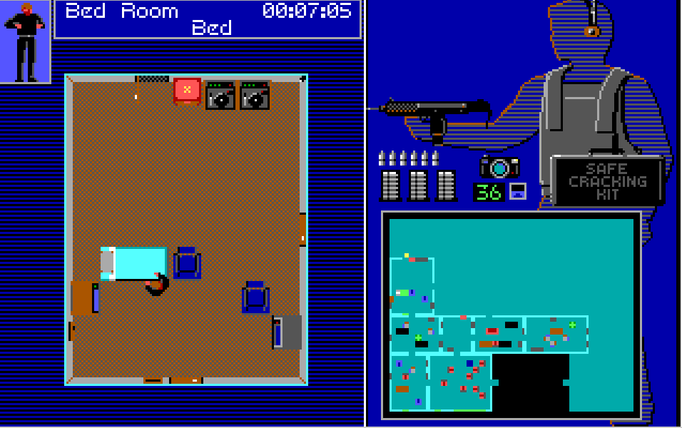

# covert-action-decomp

A source reconstruction of *Sid Meier's Covert Action* (MicroProse, 1990) for
MS-DOS.

Building the project produces executables whose load images are byte-identical
to those of the retail game, while including as little of the retail game data
as possible.

**You must own the game.** This repository does not contain it. A copy from an
official source such as GOG or Steam is required to build and to play.

## What is here

- `src/base` -- the launcher and intro programs (`COVERT.EXE`, `INTRO.EXE`),
  and `MISC.EXE`.
- `src/modules` -- the game's modules, each a separate program: `GAME`, `TAC`,
  `BUG`, `CHASE`, `CODE` and `FINAL`.
- `src/shared` -- headers and routines the programs have in common, and the
  host layer for the portable build.
- `scripts` -- the setup, build and validation scripts.

Besides the byte-identical DOS build there is:

- **A portable build.** The same C source compiles for a modern host.
- **Mod flags** that enable certain extensions to the game's logic, listed
  under [Mod Flags](#mod-flags). None is set in the byte-identical build.

## What is not here

- The **sound and graphics drivers** were not decompiled and cannot be built
  from this repository. They are taken from your copy of the game.
- **`MISC.EXE`** was not decompiled. It is included as-is, as an assembly
  listing.

## Mod Flags

Each flag switches on one change to the game. Either build takes them as
`--define NAME`, and none is set in the byte-identical build.

| Flag | What it does |
|---|---|
| `FIX_TAC_MOVE` | Smoother, more responsive keyboard movement during a break-in. |
| `TAC_EQUIPMENT_GUIDANCE` | The break-in kit screen shows how many of the five items are taken, and that Esc starts the mission. |
| `TAC_UNIMPLEMENTED_ROOMS` | Break-in buildings can include the Bed Room and the Kitchen, two kinds of room the game has data for but never generates. |
| `TAC_ROOM_RECOLOUR` | Gives those two rooms their own colours for floor, walls and furniture. Goes with `TAC_UNIMPLEMENTED_ROOMS`. |
| `TAC_PLAYER_DISGUISE_SPRITE` | The player's figure on the break-in map shows the disguise while one is worn. |
| `TAC_PHOTOS_BY_DEFAULT` | A kit without the camera still allows two photos. |
| `COVERT_SKIP_INTRO` | Skips the setup questions at the start: graphics, sound and joystick are read from `setup.txt` beside the game. DOS build only. |
| `CRIME_ULTIMATE_PLOT_FIX` | Judges whether a crime was committed against that crime's total score rather than a fixed five points, so a low-scoring crime can count too. |
| `EXTRA_MENU_OPTIONS` | Menus take Left and Right as well, for items such as sliders. |
| `DIAGNOSTICS` | Adds a Diagnostics entry to the main menu, with a page of faces, photos and MasterMinds as the game's own routines draw them. |
| `FLEXIBLE_ORIENTATION` | Asks for the agent's orientation after their sex, and uses it where the mission briefing otherwise goes by the agent's sex. |
| `COVERT_MENU_OPTIONS` | Adds a Mod Options entry to the main menu that switches the other changes on and off while playing, kept in `mods.txt`. With `COVERT_SKIP_INTRO`, an Options entry for graphics, sound and joystick too. |

A Bed Room, from `TAC_UNIMPLEMENTED_ROOMS`, in the colours `TAC_ROOM_RECOLOUR`
gives it:

## Releases

Each [release](https://github.com/RedMike/covert-action-decomp/releases) holds
the portable build for Windows and for Linux, twice: with no mod flag, and
(`-mods`) with every flag above but `COVERT_SKIP_INTRO`. An archive holds the
programs alone, so it needs your copy of the game: unpack it into the game's
folder, the one holding `FONTS.CV`, and run `covert` from the folder it makes
there. Or unpack it anywhere and set `COVERT_GAME` to the game's folder. The
Linux program needs SDL2 installed.

`.github/workflows/release.yml` builds all four on every push to `main`, and
publishes them when `version.txt` names a version that has no release yet.

## How to set up local builds

The repository builds on Linux and on Windows. The builds themselves run on
Linux, so on Windows they need WSL: the commands below are run from a Linux
shell at the top of the repository, which on Windows is a WSL one. The `.bat`
files in `scripts` are Windows shortcuts for the same commands.

1. **The game.** Copy your installed game into `original/`, so that its files
   sit under `original/MPS/COVERT/`.
2. **Packages.** DOSBox 0.74 (`dosbox`), Python 3.11 or later, and
   `pip install -r requirements.txt`. The portable build also needs `gcc`,
   a MinGW-w64 gcc (`x86_64-w64-mingw32-gcc`) for the Windows program, and
   SDL2's development files for each (the MinGW ones under
   `/usr/x86_64-w64-mingw32`).
3. **MSC 5.1 and MASM 5.1**, from your own disks:
   1. Extract the floppy images, one directory per disk:
      `python3 scripts/setup/fat12_extract.py IMAGE... --dest disks/msc51`,
      and the same into `disks/masm51`. `scripts/setup/layout_toolchain.py`
      lists the disk names it looks for.
   2. Lay the toolchain out somewhere outside the repository:
      `python3 scripts/setup/layout_toolchain.py --disks disks --dest DIR`.
   3. Copy `.env.example` to `.env` and set `DOS_TOOLCHAIN_DIR` to that
      directory.
   4. Run `scripts/setup/run_setup.sh`. It opens MSC's `SETUP /L` in a DOSBox
      window to build the combined libraries, and shows the answers to give.
4. **The reference copy.** `python3 scripts/setup/build_decompressed.py`
   (`scripts\setup_decompressed.bat`) makes `decompressed/`: your game with
   its EXEPACK'd executables unpacked, which is what a build is compared
   against.

## How to build

### DOS build

`python3 scripts/build/build.py` (`scripts\dos_build.bat`) builds every module
with MSC 5.1 and MASM 5.1 inside DOSBox, packs and unpacks each executable the
retail game shipped packed, and leaves a complete game in `rebuilt/MPS/COVERT/`.
Name modules to build only those: `build.py GAME TAC`.

To build with [mod flags](#mod-flags), name the modules and the flags, after a
normal build:

    python3 scripts/build/build.py COVERT BUG CHASE CODE FINAL GAME TAC --define FIX_TAC_MOVE --define DIAGNOSTICS

(`scripts\dos_build_mod.bat FIX_TAC_MOVE DIAGNOSTICS` names the modules
itself.) **A build with any flag is not byte-identical, and it moves the six
game modules from the small memory model to the medium one**, so the added
code is not held to the 64 KB a small-model program allows. Run a normal build
again to go back.

### Portable build

`python3 scripts/build/portable.py --all` (`scripts\portable_build.bat`)
compiles the C alone with gcc, into `portable/linux/` and `portable/windows/`.
`--platform linux` or `--platform windows` builds one of them, `--define NAME`
sets a mod flag, and `--no-window` builds without SDL2 into
`portable_headless/`.

The program reads the game's data from `rebuilt/MPS/COVERT/`, so do a DOS
build first and run the program from that directory;
`scripts\run_portable_build.bat` does that for the Windows one.

## How to test

`python3 scripts/build/validate.py` (`scripts\dos_validate.bat`) compares each
module in `rebuilt/` with the one in `decompressed/`:

- the load image, byte for byte;
- the MZ header, field by field (minimum allocation and checksum aside);
- the relocation table, as a set of sites;
- whether the retail file was packed.

Any difference is an error, and a module that was not built from the source
as it stands, or was built with a mod flag, is refused rather than measured.
`scripts\dos_build_and_validate.bat` does the build and the check in one go.

## Git History Explanation

Yes, it was all copied over as one big commit. I can't be bothered to go back 
through the working repository I've actually been doing this in to make sure 
everything in its history is safe to publish and doesn't include retail data 
or similar, and nobody needs to see a ton of tiny changes that amount to cleaning 
up garbage decompiled code into something resembling useful code.

## LLM Disclosure

The original decompilation was LLM-assisted, using Ghidra. It did an honestly
terrible job of turning things into sensible C: it was constantly and 
consistently confused by the quirks of MS C 5.1, and it made random 
assumptions that skewed the code massively. So once there was an initial draft
that produced byte-identical code, that was it for the "thinking" LLM part.

Renaming things, removing random casts, making sense of the code and
deduplicating it was literally human effort over weeks and weeks. 
For that, the LLM was used exclusively as a "glorified fuzzer": prompted to 
try various minor variations on a theme when changing things like a cast or
a small pattern, then rebuild and check for deviations. And you would not
believe the number of times I had to *argue* with it to actually try something
that it insisted "could not work" whereas it turns out that it did because
MSC 5.1 is so different from what it got trained on.

## Acknowledgements

- [canadianavenger.io](https://canadianavenger.io/), for the original help
  with decoding PAN files, which is what got me down this road.
- [f15se2-re](https://github.com/neuviemeporte/f15se2-re) and
  [neuviemeporte.github.io](https://neuviemeporte.github.io/), for a good
  pattern to follow for the decompilation, including showing that an MS C 5.1
  and MASM setup was feasible.
- [bertrandom](https://github.com/bertrandom), for posting his
  [covert-recomp](https://github.com/bertrandom/covert-recomp) repository
  while I was being lazy about cleaning this up and posting it, which forced
  me to get off my bum and set this up.

## License

Released under the [MIT license](LICENSE).
